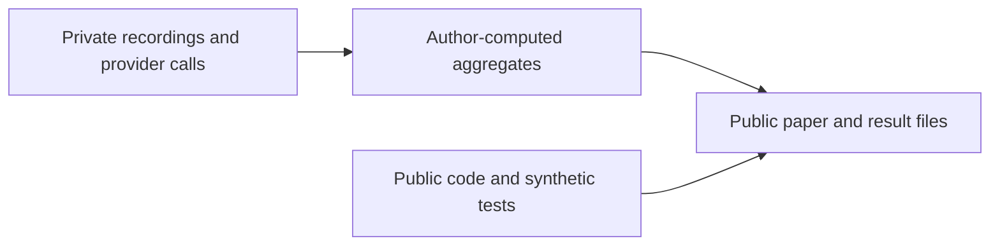

# judgment-gates

[Paper (PDF)](paper/main.pdf) · [TeX and build instructions](paper/README.md)

**TL;DR:** [26,525 book comparisons, 0 mismatches](results/research-summary.json); prospective results remain pending. 
Local classifier: [2.583/18.135 µs p50/p99](results/research-summary.json); speed has not established economic value. 
[Framing extension: 54/74 valid judgments](results/framing-summary.json); tiny, conditional CIs do not establish invariance.

Paper-only market-making research: narrow judgment gates around deterministic pricing and hard risk limits. The pilot does not establish profitable trading or emotion-free model judgment; independent-day results remain pending.

Published evidence: [calibration, replay, latency and verifier aggregates](results/research-summary.json), [forward activity and P&L decomposition](results/forward-diagnostics.json), [all framing studies and descriptive CIs](results/framing-summary.json). Missing CIs and failed routes are retained.

Install uv, then run `uv sync --frozen` and `uv run pytest -q`. [Original code](LICENSE) is MIT, Nicolas Coquelet; [third-party terms](THIRD_PARTY_NOTICES.md) apply separately.

## Publication boundary

Excluded: raw Binance/Hyperliquid books and trades, row-level features/labels, individual simulated events, trained policies, raw LLM call transcripts (`*-calls.json`), reasoning, caches, per-call timing tables, secrets, personal metadata and private Git history. Public endpoints and model-weight licences do not establish permission to redistribute exchange data or hosted outputs. See the [release decision and official exchange/provider terms](RELEASE_POLICY.md).

These are our measured counts/timings and computed statistics, not a redistribution of provider-generated content. Raw-data replay and per-call rescoring require the private inputs; the public files cannot recreate them. [EXPORT.json](EXPORT.json) pins the private source commit and published file hashes.
